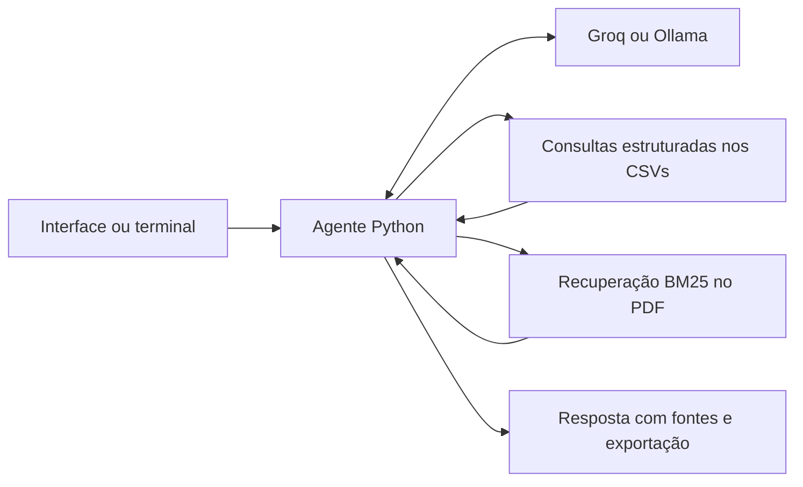
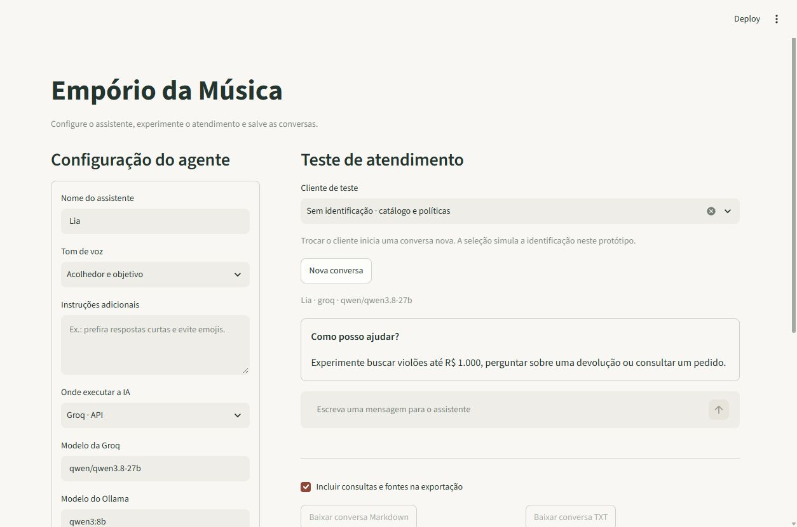

# Agente de atendimento — Empório da Música

Protótipo do desafio técnico de AI Engineer da Artefact.

## Situação atual

Desenvolvimento iniciado em 31/10/2026. Protótipo local com interface de configuração e chat, RAG sobre políticas, catálogo/preços, pedidos por cliente de teste, fontes e exportações implementados. A revisão final de entrega e a validação do modelo local Ollama continuam pendentes.
Entrega informada pelo candidato: terça-feira, 03/11/2026 às 23h59. Planejamento em America/Sao_Paulo, sujeito ao fuso indicado no e-mail.

## Funcionalidades da primeira versão

- Aplicação local em Python com interface Streamlit.
- Configuração de nome, tom e instruções adicionais do agente.
- Chat com histórico da sessão e botão para começar outra conversa.
- Consulta de catálogo, disponibilidade, preços, promoções e pedidos nos CSVs.
- Busca de trechos relevantes no PDF de políticas, com indicação da seção/página.
- Exportação da conversa em Markdown ou texto e da configuração em JSON.
- Visualização opcional das consultas e fontes usadas, sem expor raciocínio interno do modelo.
- Pedidos restritos ao cliente fictício selecionado, sem enviar nomes ou contatos ao modelo.

### Persona e estratégia de conversa

A Lia já inicia configurada como assistente virtual acolhedora, objetiva e consultiva, sem pressionar a compra. A configuração padrão orienta português brasileiro natural, ausência de emojis por padrão, parágrafos curtos, até três opções de produto e uma pergunta principal por turno somente quando necessária. Em reclamações e devoluções, deve manter empatia e explicar condições sem antecipar elegibilidade. O texto completo fica em `DEFAULT_INSTRUCTIONS`, em `emporio/profile.py`, e aparece preenchido na interface.

Nome, tom e instruções continuam editáveis; a personalização é opcional. O estilo é enviado ao modelo junto das regras fixas de consulta e acesso, que têm prioridade. São orientações de geração, não garantias automáticas de comportamento. Configurações importadas preservam o conteúdo salvo, inclusive instruções vazias; sessões já abertas precisam ser reiniciadas para carregar o novo padrão.

O [roteiro de cenários](docs/cenarios-de-teste.md) permite avaliar tom, continuidade, consultas e situações difíceis com critérios de aprovação explícitos. Ele distingue cenários propostos de evidências já executadas.

O agente é inspirado na experiência de configuração e simulação de atendimento de um projeto já desenvolvido. A implementação será independente, em Python, sem copiar código ou depender da infraestrutura do projeto de referência.

## Arquitetura

Interface Streamlit -> agente Python -> ferramentas de consulta -> CSVs e políticas.
O agente usa uma API de modelo para escolher ferramentas e redigir respostas.
Filtros, cálculos de preço e validação dos parâmetros ficam no código Python.



Groq e Ollama são os provedores escolhidos. A seleção é explícita em `LLM_PROVIDER`, sem troca automática entre processamento local e externo.
Groq depende de chave e das cotas disponíveis na conta. Ollama depende do servidor local e do modelo baixado.
A chave fica em variável de ambiente ou `.env` local, fora do Git. Os modelos são configuráveis. A Groq passou nos diagnósticos reais de saudação e chamada/retorno de ferramenta e em dois cenários de RAG sobre o manual, revisados manualmente. Ollama ainda não foi validado com modelo em execução.

## Preparar e executar

Requer Python 3.12 ou superior para as versões fixadas das dependências. Ambiente verificado: Python 3.14.4 no Windows.
No PowerShell, a partir da pasta do projeto:

```powershell
python -m venv .venv
.\.venv\Scripts\python.exe -m pip install -r requirements.lock.txt
Copy-Item .env.example .env
```

Copie o exemplo apenas na primeira configuração; preserve o `.env` se ele já contiver sua chave. Não é necessário ativar o ambiente virtual para usar os comandos abaixo.
`requirements.txt` declara as dependências diretas; `requirements.lock.txt` registra as versões instaladas nesta etapa, incluindo dependências transitivas.

### Abrir a interface

```powershell
.\.venv\Scripts\python.exe -m streamlit run app.py
```

Abra http://127.0.0.1:8501 no navegador. O servidor usa somente a interface local do computador. Para encerrar, pressione Ctrl+C no terminal.

1. Escolha nome, tom e instruções adicionais; selecione Groq ou Ollama e confira o modelo.
2. Clique em **Aplicar e iniciar nova conversa**. Alterações em rascunho não mudam uma conversa em andamento.
3. Para testar pedidos, selecione o cliente fictício. **Cliente #2** tem o **pedido 8**; o **Cliente #6** tem o **pedido 9**, sem código de rastreamento.
4. Envie mensagens. Em **Ver consultas e fontes**, confira os argumentos, resultados e trechos usados.
5. Baixe a conversa em Markdown ou TXT. A caixa de seleção permite incluir ou omitir consultas e fontes.
6. Baixe a configuração em JSON e recarregue-a por **Importar configuração** quando quiser reproduzir o estilo e a seleção de modelo.

Aplicar ou importar configuração, trocar o cliente ou clicar em **Nova conversa** limpa o histórico atual. Exporte antes de trocar, se quiser guardá-lo. A configuração JSON não inclui chave, histórico ou identidade do cliente. Credenciais são lidas do `.env`; reinicie o servidor após alterá-las.



### Usar Groq

Edite somente o `.env` local:

```dotenv
LLM_PROVIDER=groq
GROQ_API_KEY=sua_chave_pessoal
GROQ_MODEL=qwen/qwen3.8-27b
```

Crie sua chave na [conta Groq](https://console.groq.com/keys) e confira as cotas do plano gratuito antes dos testes. A disponibilidade do modelo também depende da conta. Não coloque a chave em mensagens, commits ou capturas de tela.

### Usar Ollama local

Instale o [Ollama](https://ollama.com/download/windows), deixe o servidor em execução e baixe o modelo:

```powershell
ollama pull qwen3:8b
```

Configure o `.env`:

```dotenv
LLM_PROVIDER=ollama
OLLAMA_BASE_URL=http://127.0.0.1:11434
OLLAMA_MODEL=qwen3:8b
```

Essa opção não exige chave Groq. A configuração acima usa o modelo no computador; não seleciona um modelo cloud. O download e o consumo de memória são requisitos adicionais para quem executar localmente.

### Verificar o provedor

```powershell
.\.venv\Scripts\python.exe -m emporio --check
.\.venv\Scripts\python.exe -m emporio --test-tools
```

`--check` faz uma chamada real de saudação. `--test-tools` verifica se o modelo solicita uma ferramenta de diagnóstico e usa seu resultado na resposta. Esse comando não testa catálogo ou políticas. Cada execução na Groq consome a cota da API.

Variáveis já definidas no processo têm prioridade sobre o `.env`. Rodar sem opções mostra a ajuda e não chama nenhum modelo.

### Testes sem modelo

```powershell
.\.venv\Scripts\python.exe -m unittest discover -s tests -v
```

Os testes usam respostas HTTP simuladas para verificar os dois protocolos, retorno de ferramentas, configurações e falhas. Não precisam de internet, chave ou modelo instalado e não demonstram a qualidade do atendimento real.

## Organização atual

- `emporio/config.py`: leitura e validação das configurações.
- `emporio/llm.py`: requisições Groq/Ollama e normalização de texto e ferramentas.
- `emporio/catalog.py`: consultas e cálculos de preço em Python.
- `emporio/tools.py`: ferramentas permitidas e validação de argumentos.
- `emporio/agent.py`: escolha de ferramentas pelo modelo, histórico e exportação.
- `emporio/orders.py`: pedidos vinculados ao cliente de teste definido pela aplicação.
- `emporio/profile.py`: configuração validada e exportável, sem credenciais.
- `emporio/ui.py` e `app.py`: interface Streamlit de configuração e chat.
- `emporio/__main__.py`: diagnósticos, consultas e chat por terminal.
- `emporio/policies.py`: extração por seção/página e busca lexical BM25.
- `emporio/rag.py`: recuperação, geração e validação dos identificadores de fonte.
- `data/`: cópias dos seis CSVs e do manual fornecido, sem alterar os originais.
- `tests/`: testes de integração simulada dos conectores.
- `docs/`: decisões, guia e diário.

## Catálogo e agente por terminal

Consulte os CSVs sem chamar o modelo:

```powershell
.\.venv\Scripts\python.exe -m emporio --catalog --category-id 5 --max-price 1000 --limit 3
.\.venv\Scripts\python.exe -m emporio --catalog --query "Yamaha C40" --payment pix
```

O orçamento considera o preço final para o pagamento escolhido, sem frete. Uma promoção ativa tem prioridade sobre o desconto PIX, sem acumulação. As promoções são determinadas pelo campo is_active, sem inferir vigência pela descrição ou pelo mês atual. Se houver mais de uma promoção ativa para o mesmo produto, o catálogo recusa a cotação até a regra ser esclarecida.

Valores monetários são calculados com Decimal e arredondamento ROUND_HALF_UP em centavos. Disponibilidade exige status active e estoque positivo. Itens discontinued ou coming_soon não são oferecidos para compra, mesmo com estoque cadastrado. O preço de um item indisponível pode ser informado como valor cadastrado, acompanhado do motivo da indisponibilidade.

Converse com o agente usando o provedor configurado:

```powershell
.\.venv\Scripts\python.exe -m emporio --message "Quais violões disponíveis custam até R$ 1.000?"
.\.venv\Scripts\python.exe -m emporio --chat --export local/conversa.md
```

No chat, use `/sair` para encerrar e salvar a conversa. `--show-sources` mostra consultas e resultados. A exportação contém as mensagens, parâmetros e resultados completos das ferramentas, além das fontes citadas, sem credencial.

O modelo pode escolher buscar_produtos, consultar_produto, buscar_politicas, consultar_pedido ou listar_meus_pedidos. A ferramenta de políticas executa a recuperação do PDF antes de devolver contexto ao modelo; consultas operacionais ficam nas funções de catálogo/pedidos. Os nomes de funções são uma lista fechada, sem execução de código sugerido pelo modelo.

Cada turno é limitado a quatro rodadas de geração e quatro chamadas de ferramenta por rodada. Somente turnos concluídos entram no histórico; o contexto inclui os dois últimos turnos completos. Não há persistência ou carregamento automático de sessões anteriores. As consultas usam a fotografia dos CSVs carregada ao iniciar a sessão, sem integração com estoque ao vivo.

Os resultados enviados ao modelo omitem metadados repetidos de origem para reduzir o uso de tokens; a exportação preserva a consulta completa. Referências D83 identificam o produto 83 e referências P6.2-p6-1 identificam trechos das políticas. A validação de referências não verifica automaticamente a fidelidade de todas as afirmações ou valores da resposta.

No plano gratuito da Groq, uma pergunta pode exigir várias chamadas ao modelo e exceder a cota de tokens por minuto. O programa informa o erro sem trocar de provedor ou repetir automaticamente. Aguarde a renovação da cota antes de tentar novamente. Uma conversa rápida de teste atingiu esse limite durante a validação inicial.

A conversa real de [catálogo e PIX](examples/catalogo-e-pix.md) foi concluída com intervalo entre os turnos: o agente recuperou duas opções, interpretou a referência ao primeiro produto e consultou o preço no PIX. Essa execução foi revisada contra os CSVs e o cálculo Python; não demonstra acerto para todas as reformulações.

Buscas por marca/modelo usam nome e categoria. As descrições livres não entram na busca porque há divergências no material fornecido. Filtros de cordas e captação usam os valores de specs; campo ausente não é tratado como falso. Ainda é necessário revisar divergências nas especificações antes de afirmar características não comprovadas.

## Pedidos e cliente de teste

A aplicação fixa o cliente fora dos argumentos do modelo. Uma consulta verifica essa associação antes de devolver informações; pedido inexistente e pedido de outro cliente recebem a mesma resposta. A interface começa uma conversa nova ao mudar a seleção para impedir mistura de históricos. Essa seleção é uma simulação local, não autenticação de produção.

As ferramentas devolvem somente número, status, itens, total histórico e rastreamento, com metadados das fontes. Não incluem nome, telefone, e-mail, endereço, notas ou identidade do cliente. O total do pedido não é recalculado com os preços atuais. Código ausente permanece ausente, e não existe consulta ao site da transportadora nem data efetiva de recebimento.

No terminal, o mesmo contexto pode ser selecionado explicitamente:

```powershell
.\.venv\Scripts\python.exe -m emporio --customer-id 2 --message "Qual o status do pedido 8?"
```

## Validação e limitações conhecidas

A [avaliação real da persona em 02/11](docs/avaliacao-persona-2026-11-02.md) tentou os 32 cenários pela interface: 9 aprovados, 10 aprovados com ressalvas, 12 falhas e 1 bloqueado por cota. Foram exportadas 29 conversas completas; dois casos falharam antes de entregar resposta e um permaneceu bloqueado. A rodada revelou problemas de triagem, interpretação de ambiguidade, busca de modelos indisponíveis, escopo e validação de valores que ainda precisam de correção. Os testes automatizados abaixo não devem ser interpretados como aprovação geral do atendimento. Evidências adicionais foram guardadas localmente, fora do Git, conforme descrito no relatório.

- 42 testes automatizados de preços, disponibilidade, acesso a pedidos, recuperação, protocolos de IA e fluxo da interface via Streamlit AppTest. As chamadas nesses testes são simuladas e não consomem API. As dependências fixadas foram instaladas em um segundo ambiente virtual limpo e os mesmos testes passaram, com pip check sem incompatibilidades.
- Exemplos reais em [examples/](examples/README.md), com catálogo/continuação, políticas, pedido e atendimento fora do escopo. A consulta real de pedido foi executada pela interface via AppTest com Groq. Envio de mensagem, importação da configuração e downloads Markdown/TXT/JSON também foram conferidos no navegador.
- RAG lexical pode falhar em reformulações ou recuperar trechos incompletos; citações válidas não garantem fidelidade de todas as afirmações. O comportamento de triagem de devolução ainda depende do modelo.
- Instruções de estilo são subordinadas às regras fixas no prompt e às validações do código. Isso não é uma garantia absoluta contra prompt injection.
- Histórico em memória da sessão, com dois turnos anteriores no contexto. Sem gravação automática de conversas nem credenciais exportadas. Recarregar ou encerrar a sessão pode perder o histórico; use o download.
- A cota gratuita pode interromper o fluxo. A tela mantém a pergunta com falha e oferece nova tentativa explícita; não há retry ou fallback automático.
- Ollama tem suporte de protocolo testado com respostas simuladas, mas ainda não foi validado com um modelo local instalado.
- Os dados e políticas são uma fotografia fornecida pelo desafio. Não há integração com WhatsApp real, estoque ao vivo, transportadora ou operações de compra/devolução.

Com mais tempo: ampliar a avaliação com reformulações e ataques ao prompt, comparar recuperação semântica com BM25, validar modelos locais, adicionar autenticação real e persistência com retenção definida. Essas melhorias não são apresentadas como funcionalidades existentes.

## RAG sobre políticas

O fluxo implementado é: pergunta -> busca no índice do PDF -> seleção de até quatro trechos -> geração pelo modelo -> resposta com citações e registro das fontes. O modelo recebe os trechos selecionados, não o manual inteiro.

A extração preserva seção, página e um identificador para cada trecho. Uma seção que continua na página seguinte mantém seu número e recebe a página correta. A busca usa BM25 com normalização de acentos e um vocabulário explícito de equivalências em português. Não usa embeddings nem banco vetorial.

Para verificar somente a recuperação, sem enviar dados à API:

```powershell
.\.venv\Scripts\python.exe -m emporio --retrieve "Posso acumular promoção com PIX?" --show-sources
```

Para gerar uma resposta real e exportar a evidência:

```powershell
.\.venv\Scripts\python.exe -m emporio --ask "Comprei online e quero devolver. Como funciona?" --show-sources --export local/teste-rag.md
```

`--ask` envia os trechos recuperados ao provedor selecionado. Com Groq, isso transmite conteúdo do manual ao serviço externo; use apenas com autorização sobre esse conteúdo. Com o endereço local padrão do Ollama e modelo local, a geração é feita no computador.

A exportação inclui pergunta, resposta, modelo/provedor e os trechos recuperados com seção e página. Citações `[P1]`, `[P2]`, etc., identificam esses trechos. O programa rejeita uma resposta sem citação ou com ID inexistente; isso verifica a referência, mas não prova que cada afirmação foi corretamente interpretada. A revisão de fidelidade continua sendo parte dos testes.

Se não houver correspondência lexical, o programa informa a ausência e não chama o modelo. Um score positivo não é uma probabilidade de relevância. Perguntas reformuladas fora do vocabulário podem falhar, e perguntas com muitos assuntos podem exigir mais contexto. O comando atual trata uma pergunta por execução, sem memória de conversa.

`tests/policy_questions.json` contém 14 perguntas revisadas para verificar a presença das seções esperadas entre os quatro primeiros resultados. O conjunto é pequeno e não representa uma avaliação ampla de qualidade.

Dois cenários reais de geração, sobre promoção/PIX e devolução, estão registrados em [examples/](examples/README.md), com as respostas exportadas e os trechos recuperados. O teste de devolução levou a um ajuste da instrução para pedir a data de recebimento antes de concluir elegibilidade. O cenário foi repetido e a nova resposta revisada; o ajuste de prompt não garante esse comportamento em todas as reformulações.

## Entrega planejada

- Código com instruções reproduzíveis de instalação e execução.
- Justificativas, suposições e limitações conhecidas.
- Entre 3 e 5 conversas reais de teste exportadas, incluindo aplicação de regras.
- Histórico de commits representando etapas reais do desenvolvimento.
- Declaração de uso de IA.

## Uso de IA até o momento

Codex foi usado para ler o enunciado, examinar os dados, consultar documentação oficial, analisar a referência de interface, implementar o protótipo e seus testes e preparar a documentação. As escolhas de escopo e provedores foram discutidas durante o desenvolvimento. O fluxo de trabalho foi incremental: implementar, executar testes locais e reais, revisar falhas, registrar decisões e salvar commits. Um exemplo foi a correção da triagem de devolução após uma resposta que confirmou elegibilidade antes de perguntar a data de recebimento. Evidências e limitações estão registradas no diário.

## Documentação

- [Auditoria dos dados e ambiguidades do material fornecido](docs/auditoria-dados-2026-11-02.md)
- [Guia para acompanhar as etapas](docs/guia-do-projeto.md)
- [Decisões e questões em aberto](docs/decisoes.md)
- [Diário do desenvolvimento](docs/diario.md)

## Referências técnicas consultadas

- https://docs.streamlit.io/develop/api-reference/chat
- https://docs.streamlit.io/develop/api-reference/widgets/st.download_button
- https://console.groq.com/docs/openai
- https://console.groq.com/docs/tool-use/overview
- https://console.groq.com/docs/rate-limits
- https://docs.ollama.com/api/chat
- https://docs.ollama.com/capabilities/tool-calling
