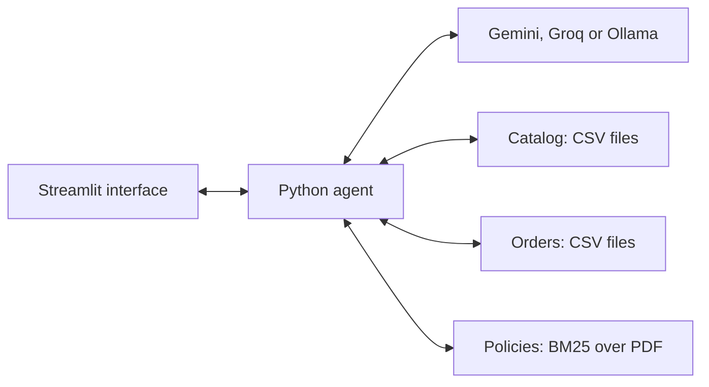

# Empório da Música - customer service agent

Luccas Bassani | AI Engineer technical challenge - Artefact | 3 November 2026

[Project repository](https://github.com/LuccasBassani/emporio-agente)

A Python prototype that answers questions about instruments, prices, availability, orders and store policies. I prioritized a local application that is straightforward to run, with traceable queries against the supplied data and real interaction examples.

## Scope and persona

Lia serves customers in Brazilian Portuguese with a warm, concise and consultative tone. She should use the conversation context, ask one necessary question at a time and redirect unrelated requests. For returns and warranties, she guides customers towards staff review without approving requests herself.

I defined the interface reference, persona and scope. The interface supports agent configuration, chat, inspection of queries, and conversation/configuration exports. The Python implementation is independent of the reference used.

## Architecture and technical decisions



- **Python and Streamlit:** interface and agent share one language, keeping setup simple for the demonstration.
- **Function calling and Python functions:** the model selects from five tools; Python validates arguments, queries CSVs and calculates prices with `Decimal`. Direct queries suit the supplied data volume without an additional database.
- **Lexical RAG with BM25:** the manual is small. Local retrieval returns up to four passages with section/page provenance, without requiring an embedding service.
- **Gemini Flash-Lite for the demonstration:** tool support and free-tier capacity observed during testing. Groq remains configurable; the Ollama connector is implemented but has not been validated with an installed local model.

The agent uses `httpx` without an agent framework to keep the tool request, execution and response cycle explicit. The prompt separates query rules, limits and sources from style preferences. Model context includes the previous two complete turns.

<!-- pagebreak -->

## Setup and execution

Requires Python 3.12 or later. Verified environment: Windows with Python 3.14.4. In PowerShell, from the repository directory:

```powershell
python -m venv .venv
.\.venv\Scripts\python.exe -m pip install -r requirements.lock.txt
Copy-Item .env.example .env
```

Copy the example only during initial setup. In `.env`, select Gemini and enter your own key from [Google AI Studio](https://aistudio.google.com/apikey):

```dotenv
LLM_PROVIDER=gemini
GEMINI_API_KEY=your_key
GEMINI_MODEL=gemini-3.5-flash-lite
```

```powershell
.\.venv\Scripts\python.exe -m streamlit run app.py
```

Open [http://127.0.0.1:8501](http://127.0.0.1:8501). Lia is already configured. For order tests, select **test customer #2** and ask about **order 8**; **customer #6** has **order 9**, without tracking information. Expand each answer to inspect queries and sources. The [interface screenshot](docs/interface.png) shows the flow.

Changing the customer, applying configuration or starting a new conversation clears the current history. Download buttons export conversations as Markdown/TXT and configuration as JSON. API keys remain in `.env`, outside Git and exports; restart the server after changing them. Existing process environment variables take precedence over the file.

### Alternative providers

For Groq, set `LLM_PROVIDER=groq`, `GROQ_API_KEY` and `GROQ_MODEL=qwen/qwen3.8-27b`. For Ollama, install its server, run `ollama pull qwen3:8b`, and set `LLM_PROVIDER=ollama`, `OLLAMA_MODEL=qwen3:8b` and `OLLAMA_BASE_URL=http://127.0.0.1:11434`.

Provider selection is explicit, without automatic fallback. External APIs depend on account quotas. For Gemini's free tier, review the [data-use terms](https://aistudio.google.com/docs/pricing). This demonstration uses the fictional challenge data and omits customer contact fields from order-tool results.

### Tests and command line

```powershell
.\.venv\Scripts\python.exe -m unittest discover -s tests -v
.\.venv\Scripts\python.exe -m emporio --help
```

Local tests need no API key or network. The CLI also supports catalog queries, policy retrieval and chat. `--check` and `--test-tools` make real diagnostic requests to the selected provider.

<!-- pagebreak -->

## Data rules and validation

Availability requires active status and positive stock. An active promotion takes precedence over the PIX discount; discounts do not stack. Historical order totals are preserved. Data conflicts and policy gaps are recorded separately, without modifying the original sources.

The application fixes the test customer outside model arguments and restricts orders to that selection. Missing orders and another customer's orders receive the same guidance. Order tools return only necessary operational fields, excluding customer names and contact details.

**61 automated tests passed**, covering pricing, order access, retrieval, provider contracts and the interface. API responses are mocked in these tests. A real-API evaluation covered **32 scenarios: 12 passed, 15 passed with caveats and five failed**. After fixes, all five met their main objective in targeted retests, with caveats remaining in two. A shipping assertion regression in an order answer was also fixed and retested.

The full suite of 32 real scenarios was not rerun after the last fix. The [evaluation report](docs/validacao-gemini-2026-11-03.md) identifies each revision. There are [five real examples](examples/README.md), also included in [Interaction examples and review](docs/entrega.md).

## Limitations and next steps

- Lexical retrieval can miss paraphrases; valid citations do not verify every claim. Tone, triage and price qualifications still vary across generations.
- Customer selection is a demonstration, without real authentication. CSVs are snapshots; the agent does not execute purchases, returns or live carrier queries.
- History is session-based, with two previous turns in model context. Ollama needs validation with a local model; external APIs depend on capacity and availability.

With more time, I would prioritize guardrails, structured triage and previous-interaction memory. Larger datasets would motivate hybrid retrieval and database/API queries. Fine-tuning would be a later experiment for tone and behavior using reviewed conversations and separate evaluation. See [Improvements with more time](docs/entrega.md#improvements-with-more-time).

## AI assistance and project ownership

I used Codex to support implementation, test creation/execution and documentation. I directed the interface reference, persona, scope and provider choices, focusing on cost and simplicity.

I also guided test scenarios and expected outcomes, reviewed answers and prioritized fixes. When proposed approaches were too complex for the challenge, I directed their simplification. Development proceeded incrementally, using queries, answers and tests to review each stage.
