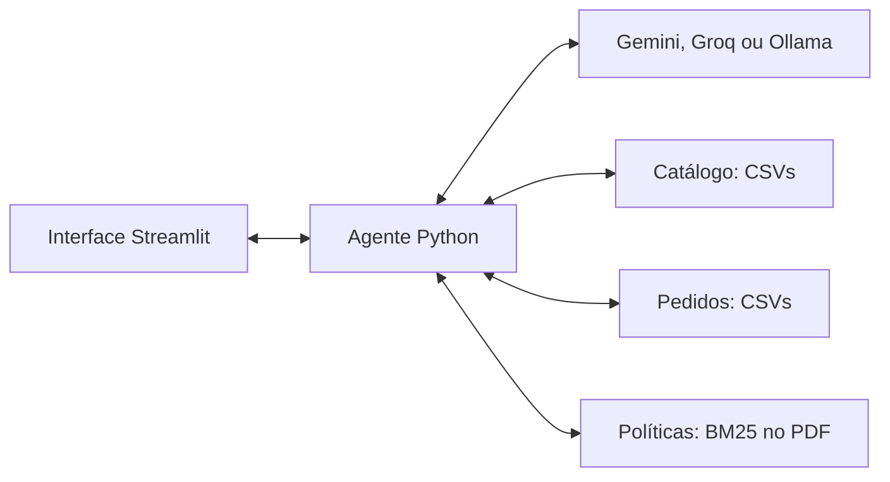

# Empório da Música - agente de atendimento

Luccas Bassani | Desafio técnico de AI Engineer - Artefact | 03/11/2026

[Repositório do projeto](https://github.com/LuccasBassani/emporio-agente)

Protótipo em Python para responder dúvidas sobre instrumentos, preços, disponibilidade, pedidos e políticas da loja. Priorizei uma aplicação local simples de executar, com consultas verificáveis aos dados fornecidos e exemplos reais de atendimento.

## Escopo e persona

A Lia atende em português, com tom acolhedor, objetivo e consultivo. Deve aproveitar o contexto, fazer uma pergunta necessária por vez e redirecionar assuntos fora da loja. Em devoluções e garantias, orienta a análise pela equipe sem aprovar solicitações.

Defini a referência de interface, a persona e o escopo. A tela permite configurar o agente, conversar, conferir consultas e exportar conversas e configurações. A implementação é independente da referência utilizada e concentra a aplicação em Python.

## Arquitetura e decisões técnicas



- **Python e Streamlit:** interface e agente na mesma linguagem, com pouca configuração para demonstrar o atendimento.
- **Function calling e funções Python:** o modelo escolhe entre cinco ferramentas; o código valida argumentos, consulta CSVs e calcula preços com `Decimal`. O volume fornecido permite consultas diretas, sem banco de dados adicional.
- **RAG lexical com BM25:** o manual é pequeno. A busca local recupera até quatro trechos, preservando seção e página, sem exigir um serviço de embeddings.
- **Gemini Flash-Lite na demonstração:** suporte a ferramentas e capacidade gratuita observada nos testes. Groq é alternativa configurável; Ollama é opção local implementada, ainda sem validação com modelo instalado.

O agente usa `httpx`, sem framework de agentes, para manter explícito o ciclo de chamada, execução e retorno das ferramentas. O prompt separa regras de consulta, limites e fontes das preferências de estilo. O contexto mantém os dois turnos anteriores completos.

<!-- pagebreak -->

## Instalação e execução

Requer Python 3.12 ou superior. Ambiente conferido: Windows com Python 3.14.4. No PowerShell, dentro da pasta do repositório:

```powershell
python -m venv .venv
.\.venv\Scripts\python.exe -m pip install -r requirements.lock.txt
Copy-Item .env.example .env
```

Copie o exemplo apenas na primeira configuração. No `.env`, selecione Gemini e preencha sua chave, criada no [Google AI Studio](https://aistudio.google.com/apikey):

```dotenv
LLM_PROVIDER=gemini
GEMINI_API_KEY=sua_chave
GEMINI_MODEL=gemini-3.5-flash-lite
```

```powershell
.\.venv\Scripts\python.exe -m streamlit run app.py
```

Abra [http://127.0.0.1:8501](http://127.0.0.1:8501). A Lia já vem configurada. Para testar pedidos, selecione **Cliente #2** e consulte o **pedido 8**; o **Cliente #6** tem o **pedido 9**, sem rastreamento. O expansor de cada resposta mostra consultas e fontes. A [captura da interface](docs/interface.png) apresenta o fluxo.

Trocar cliente, aplicar configuração ou iniciar nova conversa limpa o histórico atual. Os botões de download salvam a conversa em Markdown/TXT e a configuração em JSON. Chaves ficam no `.env`, fora do Git e das exportações; reinicie o servidor após alterá-las. Variáveis já definidas no processo têm prioridade sobre o arquivo.

### Outros provedores

Para Groq, use `LLM_PROVIDER=groq`, `GROQ_API_KEY` e `GROQ_MODEL=qwen/qwen3.8-27b`. Para Ollama, instale o servidor, execute `ollama pull qwen3:8b` e use `LLM_PROVIDER=ollama`, `OLLAMA_MODEL=qwen3:8b` e `OLLAMA_BASE_URL=http://127.0.0.1:11434`.

A seleção é explícita, sem troca automática de provedor. APIs externas dependem das cotas da conta. No nível gratuito do Gemini, confira as [condições de uso dos dados](https://aistudio.google.com/docs/pricing); esta demonstração utiliza dados fictícios e omite contatos pessoais nas consultas ao modelo.

### Testes e terminal

```powershell
.\.venv\Scripts\python.exe -m unittest discover -s tests -v
.\.venv\Scripts\python.exe -m emporio --help
```

Os testes locais não precisam de chave ou rede. O terminal também oferece catálogo, busca de políticas e chat. `--check` e `--test-tools` fazem chamadas reais de diagnóstico ao provedor selecionado.

<!-- pagebreak -->

## Regras de dados e validação

Disponibilidade exige status ativo e estoque positivo. Uma promoção cadastrada como ativa prevalece sobre o desconto PIX, sem acumulação. Totais históricos dos pedidos são preservados. Divergências cadastrais e lacunas do manual ficam em notas separadas, sem alterar as fontes originais.

A aplicação fixa o cliente fora dos argumentos do modelo e restringe os pedidos a essa seleção. Pedido ausente e pedido de outro cliente recebem a mesma orientação. As ferramentas de pedidos retornam somente os campos operacionais necessários, sem nomes ou contatos de clientes.

**61 testes automatizados passaram**, cobrindo preços, acesso a pedidos, recuperação, contratos dos provedores e interface. As respostas de API são simuladas nesses testes. Uma avaliação com API real cobriu **32 cenários: 12 aprovados, 15 com ressalvas e cinco falhas**. Após correções, os cinco casos tiveram o objetivo principal atendido nos retestes, com ressalvas em dois deles. Uma regressão de frete no texto de pedido também foi corrigida e repetida.

Não houve nova rodada integral após a última correção. O [relatório de avaliação](docs/validacao-gemini-2026-11-03.md) distingue as revisões. Há [cinco exemplos reais](examples/README.md), também apresentados na seção de [exemplos de atendimento e revisão](docs/entrega.md).

## Limitações e próximos passos

- A recuperação lexical pode perder reformulações; citações válidas não comprovam toda afirmação. Tom, triagem e condições de preço ainda variam na geração.
- O cliente é selecionado para demonstração, sem autenticação real. CSVs são uma fotografia; o agente não executa compras, devoluções ou consultas ao vivo à transportadora.
- O histórico fica na sessão, com dois turnos anteriores no contexto. Ollama ainda precisa de teste com modelo local; APIs externas dependem de disponibilidade e cota.

Com mais tempo, priorizaria guardrails, triagem estruturada e memória de atendimentos anteriores. Para bases maiores, avaliaria busca híbrida no RAG e consultas a banco de dados ou APIs. Fine-tuning seria um experimento posterior para tom e comportamento, com conversas revisadas e avaliação independente. As propostas estão detalhadas na seção [Melhorias com mais tempo](docs/entrega.md#melhorias-com-mais-tempo).

## Uso de IA e condução do trabalho

Usei o Codex como ferramenta de apoio à implementação, à criação e execução de testes e à documentação. Conduzi a definição da referência de interface, persona, escopo e provedores, com atenção ao custo e à simplicidade da solução.

Também orientei os cenários de teste e os resultados esperados, revisei respostas e priorizei correções. Ao identificar propostas complexas para o desafio, direcionei sua simplificação. O trabalho avançou em incrementos, usando consultas, respostas e testes para revisar o resultado de cada etapa.
